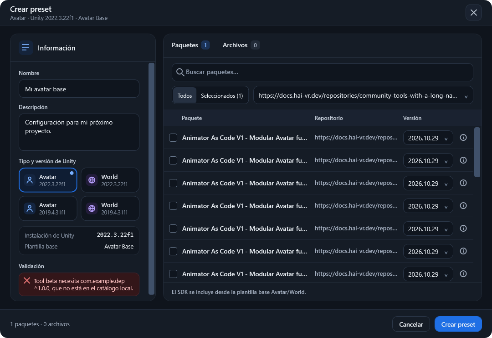
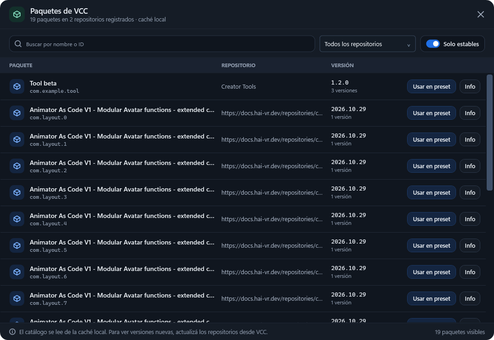

# MochiSprout

**Tu próximo proyecto, listo.** Aplicación de escritorio para Windows que prepara configuraciones reutilizables de proyectos de VRChat y las convierte en plantillas de [VRChat Creator Companion (VCC)](https://vcc.docs.vrchat.com/).

Elegís una vez el tipo de proyecto (Avatar o World), la versión de Unity, los paquetes VPM y tus archivos `.unitypackage`, y cada proyecto nuevo arranca con todo eso listo.



## Qué hace

- **Presets locales.** Guardá combinaciones de tipo, Unity, paquetes con su versión exacta y archivos `.unitypackage`. Guardar no toca VCC ni crea proyectos.
- **Catálogo real de VCC.** Lee los repositorios que tenés registrados en VCC y su caché local. Muestra versiones, dependencias, Unity mínimo y autor de cada paquete.
- **Validación en vivo.** Avisa si falta una dependencia (y la agrega con un clic), si un paquete pide un Unity más nuevo o si un archivo enlazado ya no existe.
- **Exportar a VCC.** Genera una plantilla nueva en `Templates` de VCC a partir de una base oficial compatible. Revisa todo antes, nunca modifica la base oficial y nunca sobrescribe una plantilla existente.
- **Importación automática de `.unitypackage`.** Los archivos se enlazan por su ruta original, sin copiarlos. Al abrir en Unity un proyecto creado desde la plantilla, un script de Editor los importa en orden y recuerda cuáles ya importó.



## Descarga

1. Bajá `MochiSprout-v1.0.0-windows.zip` desde [Releases](https://github.com/AkiMoriDev/MochiSprout/releases/latest).
2. Descomprimilo en cualquier carpeta.
3. Abrí `MochiSprout.exe`.

No necesita instalación.

## Requisitos

- Windows 10 u 11 (x64).
- [.NET Desktop Runtime 8](https://dotnet.microsoft.com/download/dotnet/8.0) para ejecutar la app.
- VRChat Creator Companion instalado y al menos una instalación de Unity 2019 o 2022 (Unity Hub o agregada a mano).

## Cómo se usa

1. Abrí MochiSprout. Arriba vas a ver si encontró VCC, tus instalaciones de Unity y el catálogo de paquetes.
2. Creá un preset con **Nuevo preset** o partí de una plantilla oficial con **Usar como base**.
3. Elegí tipo y versión de Unity, marcá los paquetes y agregá tus `.unitypackage` (también podés arrastrarlos).
4. **Crear preset** muestra una revisión completa antes de guardar.
5. En la tarjeta del preset, **Exportar a VCC** crea la plantilla.
6. En VCC, creá un proyecto nuevo con esa plantilla y abrilo en Unity: los `.unitypackage` se importan solos.

### Si algo falla al importar en Unity

El importador reintenta una vez por su cuenta, retoma importaciones interrumpidas y busca archivos que se movieron a carpetas cercanas. Si no puede resolverlo, muestra una ventana con opciones (reintentar, buscar el archivo, importar una versión distinta u omitirlo).

En Unity también tenés el menú **Tools → MochiSprout**:

- **Ver estado de importación**
- **Reintentar archivos pendientes**

El script usa solo C# 4 y accede por reflexión a las APIs del Editor que cambian entre versiones, para compilar desde Unity 2017.4 hasta Unity 6. Se verificó compilándolo contra Unity 2019.4 y 2022.3.

## Dónde guarda los datos

| Qué | Dónde |
|---|---|
| Presets, preferencias y registro de plantillas exportadas | `%LocalAppData%\Akimorivt Systems\MochiSprout` |
| Plantillas exportadas | `%LocalAppData%\VRChatCreatorCompanion\Templates` |
| Estado de importación de cada proyecto | `ProjectSettings/MochiSproutImportState.json` dentro del proyecto de Unity |

Si venís de VCC Preset Studio (el nombre anterior de la app), la primera vez que abras MochiSprout se copian tus datos desde `%LocalAppData%\VCCPresetStudio` (la carpeta anterior no se borra). Los proyectos de Unity preparados con la versión anterior se actualizan solos al volver a prepararlos: se reemplaza el importador viejo y se conserva su registro de importaciones.

## Estructura

```
MochiSprout/              App WPF (.NET 8)
  Controllers/            PresetController: casos de uso y estado de la interfaz
  Models/                 Presets, catálogo y preferencias
  Services/               VCC, VPM, Unity, persistencia y exportación
  Views/                  Vistas XAML y modales
  Resources/              Script del importador que se copia a los proyectos de Unity
  Assets/Themes/          Tema oscuro, colores e íconos vectoriales
Verification/             Comprobaciones automáticas de la app
  ImporterHarness/        Pruebas del importador con Unity simulado
docs/screenshots/         Capturas para este README
```

Arquitectura: WPF con organización MVC (Models, Views, Controllers, Services) y bindings con [CommunityToolkit.Mvvm](https://github.com/CommunityToolkit/dotnet). Inyección de dependencias con `Microsoft.Extensions.DependencyInjection`.

## Limitaciones conocidas

- Los `.unitypackage` se enlazan por ruta absoluta: si los movés, borrás o usás la plantilla en otra PC, hay que volver a enlazarlos.
- No resuelve todos los rangos de versiones ni las dependencias transitivas; la resolución final la hace VCC.
- Todavía no hay forma de borrar presets ni de sobrescribir una plantilla ya exportada desde la app.
- La importación de punta a punta dentro de Unity real no tiene pruebas automáticas; el importador se prueba con un Unity simulado.

## Licencia

[MIT](LICENSE).

Hecho por **Akimorivt Systems**. MochiSprout no está afiliado a VRChat Inc. ni a Unity Technologies.
